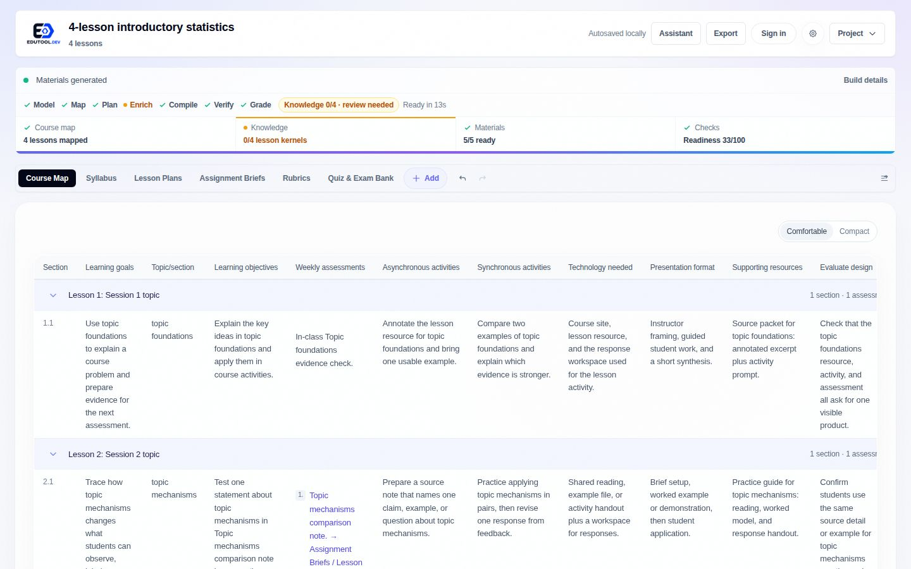
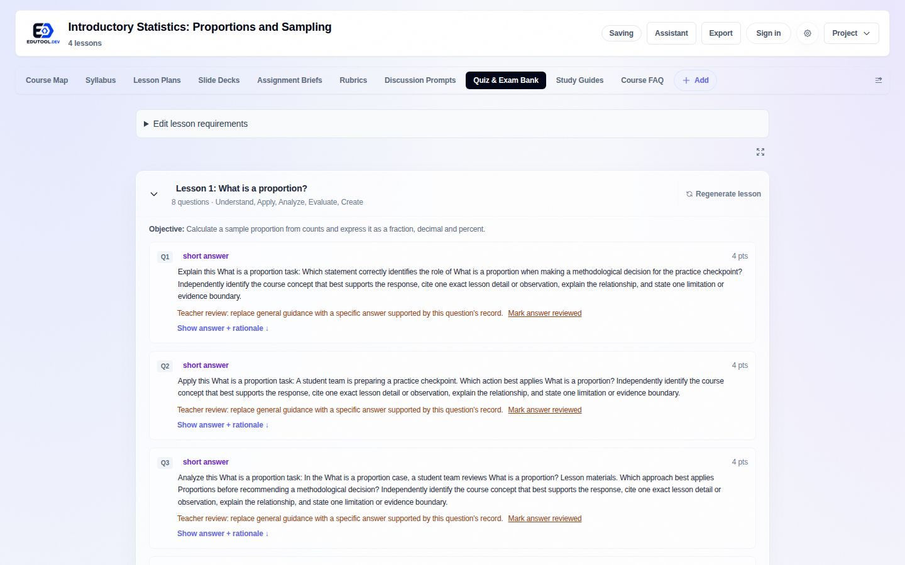
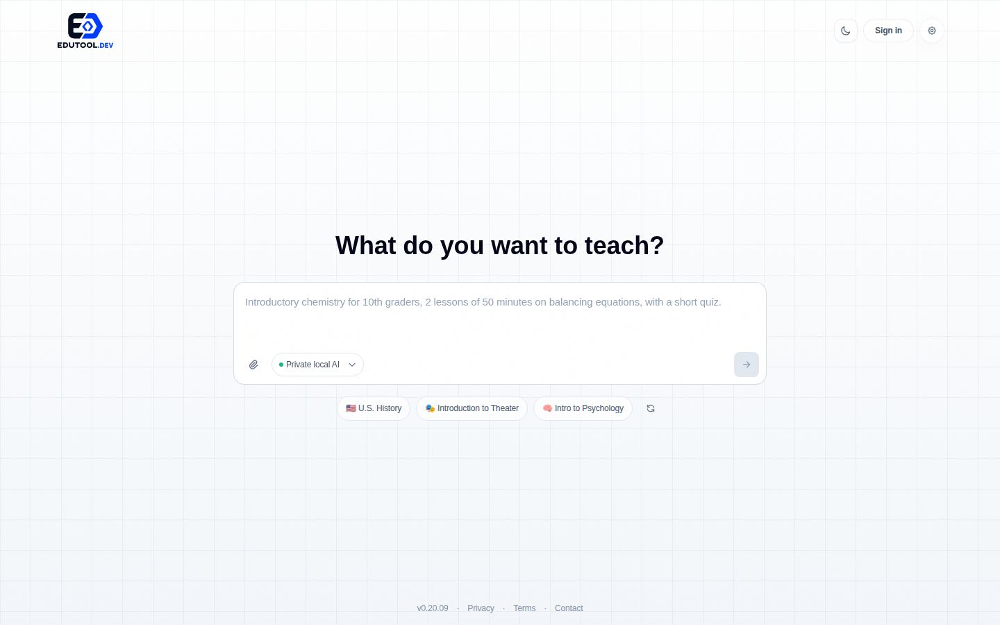

# Folio — Design Doc

Sep 26, 2026 · Living version with diagrams and comments: https://claude.ai/code/artifact/ffbdc1c9-66b8-4a27-ba8d-14b56ffc9ed4

## TL;DR

Rebuild EduTool as Folio, a small, typed, lesson-first "course binder": one course document is the only source of truth, and each of the ten materials is a view of it. Today's product has good instincts, but they are buried under about 292k lines of mostly untyped JavaScript. There are at least eight overlapping course formats, a 29,138-line regex compiler, and roughly 10.5k lines that repair model output after it arrives.

The new version rests on four decisions:

1. **One schema.** A single Zod-validated `Course` with stable IDs replaces every current format. Lessons, tasks, questions and sources are all entities inside it. Edits and AI proposals go through one command bus, so undo, history and "what changed" come for free.
2. **Lesson-first navigation.** The workspace opens on a lessons × materials grid (the course map, promoted to home screen). Teachers move along both axes: "everything for Tuesday" or "the whole quiz bank".
3. **A real visual identity.** The look is editorial "paper and ink": warm paper surfaces, a serif for documents, a precise sans for the interface, one ink-blue accent, and a restrained ten-color binder-tab system for materials. It replaces the generic Tailwind-slate look.
4. **Model-agnostic, schema-first AI.** Generation is small and structured (one lesson, one task, one question at a time) through a single `Inference` port. Behind it sit bring-your-own-key cloud models and optional local Scion. Output is validated against schemas before it is committed, never regex-patched afterwards.

The target is about 25–35k lines of TypeScript, an initial download under 150 KB gzip, and WCAG 2.2 AA. It ships in five gated phases, the first being a single lesson with three materials, before replacing the current app.

## The name: Folio · 墨页

The new product is called **Folio**, and **墨页** in Chinese. A folio is a single sheet folded into pages, and also a portfolio that holds work together. That is what this design is: sheets of teaching material, bound into one course.

### Why it fits the design

- **Paper and ink.** The visual language is sheets on a desk (section 4). A folio _is_ the sheet.
- **One truth, many pages.** A folio is one sheet folded into several pages. In the same way, one course document becomes ten materials (section 6.2).
- **The binder.** Teachers keep lessons in folios, so the binder-tab system becomes the brand mark.
- **Plain and bilingual.** It is short and easy to say in English and Chinese. It avoids the "Edu-", "AI" and "GPT" clichés and sounds like a notebook, not a platform.
- **墨页 (ink + page).** The name uses the two materials of the design. It reads calm and literary rather than technical.

### Brand system

| Element          | Decision                                                                                             |
| ---------------- | ---------------------------------------------------------------------------------------------------- |
| Wordmark         | `folio` in lowercase Instrument Serif; the dot of the _i_ is a small ink drop in `accent` blue       |
| Mark             | A sheet with a folded corner and one binder tab on its right edge; legible as a 16 px favicon        |
| Tagline          | "Your course, bound together." / 中文：“一门课，装订成册。”                                          |
| In-product names | File type `.folio`, evaluation repo `folio-evals`, hosted service "Folio relay"                      |
| Transition       | Launch as "Folio, from EduTool" on the current domain, then move to Folio's own domain after cutover |

Three other names were considered and set aside:

- **Quire** (a gathering of sheets): lovely, but hard to pronounce.
- **Margin**: says nothing about building a course.
- **Lectern**: loses the paper idea.

"Folio" is a common word, so a trademark and domain check is required before the public beta (see 8.4).

## 1. Audit of the current project

The product idea is right, but the codebase can no longer carry it. EduTool (repo `CourseMapper`, v0.20.09) turns a course description into ten linked, editable teaching materials and exports them. Measured at commit `63d8172`, the structure makes every change expensive and every screen crowded.

### 1.1 By the numbers

| Measure                                                    | Value                                                                                                             |
| ---------------------------------------------------------- | ----------------------------------------------------------------------------------------------------------------- |
| Production source in `src/`                                | \~291.8k lines JS vs \~7.4k TS (97.5% untyped)                                                                    |
| Files in flat `src/lib` top level                          | 415 (170k lines)                                                                                                  |
| Largest file (`courseBlueprintCompiler.js`)                | 29,138 lines, 574 functions, \~183 regex tests                                                                    |
| Largest React unit (`generateAll` in `useDeliverables.js`) | one 5,168-line `useCallback`, 17 deps                                                                             |
| `AppFlow.jsx`                                              | 4,724 lines; 24 `useState`, 19 `useEffect`, 28 `useRef`; \~66 props into `ChatPanel`                              |
| Overlapping course representations                         | 8+ (courseMap, CourseIR, CourseGraph, blueprint, teachingProgram, genome, intent graph, lesson bundle) + Studio's |
| Post-generation repair and grading                         | \~10.5k lines, 144 regex replaces                                                                                 |
| Test files / actually run by any script                    | 477 / \~207 (about 55% of unit tests never run)                                                                   |
| Build output                                               | 333 assets, 13 MB JS, 49 MB `dist`; pdfmake 1.3 MB; Changelog route 674 KB                                        |
| Local model download                                       | 3.35 GB (Gemma 4 E2B, 5 shards)                                                                                   |
| Build/test configs                                         | 2 Vite, 4 Vitest, 3 Playwright, 2 tsconfig                                                                        |

### 1.2 Structural problems, most severe first

1. **No single source of truth.** Every course is stored in at least eight overlapping formats. Materials are linked to lessons by array position, not ID. Lesson count, minutes and quiz size are written into the prompt text, then read back out with regexes (`courseShape.js`).
2. **Model output is patched after the fact, not constrained before.** Prompts are ALL-CAPS rule lists describing JSON with abbreviated keys, parsed with `jsonrepair`. Three repair layers then fix what comes out. `artifactDefectPatterns.js` exists to catch bugs the templates create, such as "Use Use" or "\[object Object\]".
3. **A heuristic compiler posing as intelligence.** Subject detection is keyword regex, and copy comes from rotating sentence templates. There are special-case modules for music theory, propositional logic and discrete maths. That is tuning to benchmark courses, not generalisation.
4. **God orchestrators.** Generation, sync and persistence live inside React hooks and one 4.7k-line controller, so the pipeline cannot run headless or be tested in isolation.
5. **State split five ways.** Two contexts, a reducer, `AppFlow` locals and hook refs all hold course state. Saved snapshots mix course data with UI state (active tab, slide theme, chat history).
6. **Fragile persistence.** Local save has five fallback tiers. The "pruned" tier silently drops teacher edits and version history when storage fills up.
7. **Two apps in one repo.** The shipped JS app and an unshipped strict-TS "Studio" duplicate inference, exporters (the Google client ID is hard-coded twice) and storage. A build rule stops them sharing any code.
8. **Weak guarantees.** The shipped app is never type-checked, lint runs `--quiet`, and most unit tests are orphaned from every suite.
9. **Security shaped by hosting.** GitHub Pages cannot send headers, so the CSP is a meta tag. It allows all of jsDelivr (any npm package), `unsafe-inline` styles and a broad `connect-src`. Scripts are loaded from CDNs without integrity checks, and App Check is off.
10. **Repo sprawl.** Research (5.9 MB), benchmarks (1.1 MB), 17 MB of fonts for the unshipped app and 15 MB of vendored WASM runtimes (one copy byte-identical) sit in the app repo. There are 782 version-tag comments, 6,657 lines of release notes as source, and three competing rebuild plans in `docs/`.

### 1.3 What the evidence says about the AI

The project's own records show the model path is the weakest link. The v3 probe formed no shared task in any of 36 inputs. The best-rated example in the latest live benchmark came from "no model call". Earlier plans kept a hard constraint of local-only inference. That constraint is what produced the sprawl: two wllama integrations, a string-patched vendored runtime, 17k lines of `scion*` code and 16k lines of regex repair.

### 1.4 What to keep

- **Studio's domain layer.** `domain.ts` defines one Zod `CourseSchema` with stable IDs, a revision counter, an edit log and cross-reference invariants. Materials there are derived views, and `scion.ts` puts model calls behind one `Inference` interface.
- **The rule that `src/lib` never imports React.** Enforce it as a lint boundary, as the `curriculumos` facade intended.
- **Server security work.** Firestore revision checks (compare-and-swap), `authoringCore`'s grants and idempotency, and the Durable Object quota design.
- **The sync idea.** A map from course fields to affected materials, re-keyed on stable IDs.
- **The ten material categories, the export breadth and the v0.20.07 simplification principles:** say each thing once, one drawer at a time, give the material the space.
- **Benchmark datasets.** Keep them, but in a separate evaluation package.

### 1.5 Interface and visual design

The biggest interface problem is trust, not styling. We ran the real flow with the prompt "4-lesson introductory statistics…". It produced lessons titled "Session 1 topic" filled with "topic foundations", and statistics was never mentioned. The status still showed a green "Materials generated"; only "Build details" revealed "Readiness 33/100".



The quiz view shows the same problem up close. Slot-filled stems such as "Explain this What is a proportion task" are each followed by the same brown "Teacher review" warning. Every line is 12–14 px, so the lesson title, labels and questions barely differ in weight.



The homepage has the right idea: one question and one box. Its execution is generic. It uses a faint grid background, system Arial because Inter is declared but never loaded, a raster logo left over from CourseMapper, emoji example chips, and three different shapes of header control.



**Design system, measured:**

| Measure                                      | Value                                                                        |
| -------------------------------------------- | ---------------------------------------------------------------------------- |
| Colour hues in use / distinct colour classes | 16 / 320 (slate 3,137 uses, indigo 910, amber 509…)                          |
| Hard-coded hex values                        | 140 in JSX/JS (83 distinct) + 62 in `index.css`                              |
| Semantic token uses vs raw palette classes   | 88 vs \~5,900                                                                |
| `index.css`                                  | 1,375 lines, 189 `!important`, \~250 `.dark` overrides                       |
| Dark-mode systems competing                  | 3: CSS variables, global `!important` overrides, 1,254 `dark:` classes       |
| Distinct button looks                        | 80 across 436 buttons; the shared `Button` is used on 2 legal pages only     |
| Text set at 10 px                            | \~440 elements                                                               |
| Emoji in the UI                              | 119 characters, plus ✓ ✗ ⚠ as status glyphs read aloud by screen readers     |
| Icons                                        | 357 inline Heroicons v1 paths; Syllabus/Assignments and Quiz/FAQ share icons |

**Information architecture:**

- **No URLs inside the workspace.** Back and deep links don't work.
- **Controls in several places.** Theme sits in two menus. The gear holds only "Developer Mode". Two menus can be open at once and overlap.
- **Tabs that don't behave like tabs.** Tabs are draggable toggle buttons with no tab semantics, so a swipe on a phone can't scroll them. A hover popover stays open and covers content.
- **Header weight.** Every material view opens with an "Edit lesson requirements" bar set larger than the lesson title. On phones the header stack pushes content down to y≈350 of 844.
- **Colour meaning.** Each material invents its own colours: amber warm-ups, rose discussions, teal guides, cyan FAQ, and four-colour rubric chips.
- **Contradictory model messages.** AI settings says "no model download"; setup says a 3.35 GB download is needed. Export always says "Ready to export", even at 33/100.

**Accessibility:**

- Placeholder contrast is 2.56:1, and dark placeholders 2.22:1.
- The "fixed" slate-400 text measures 4.38:1 against the 4.5:1 AA minimum.
- 27 `focus:outline-none` overrides remove the focus ring.
- Menus are `<details>` elements with no Escape handling.
- 147 `title` tooltips are unreachable by keyboard and touch.
- The good parts: a global focus ring exists, reduced motion is respected, and there are 59 live regions.

**Jargon teachers see:** Scion, Run Scion, Enrich / Compile / Verify / Grade, lesson kernels, Readiness 33/100, Developer Mode, "Tell the agent…", applied artifact, evidence boundary, admitted claims, Algi V0.

**What is working:**

- The slide editor: artboard, thumbnail rail, themes and speaker notes.
- The syllabus, which reads most like a real document.
- The setup page's steppers and checklist.
- The unshipped Studio's paper-and-chalk direction, which has real personality. This redesign builds on it, adding dark mode, accessibility and a single token system.

## 2. Product vision and principles

Folio is the teacher's binder, made intelligent: describe what you want to teach, get a coherent set of materials, and fix one thing without re-fixing ten documents.

**Promise:** from a paragraph to a classroom-ready, editable course in under five minutes, where every material agrees with every other.

### 2.1 Who it is for

| User                             | Situation                                        | What they need most                                                     |
| -------------------------------- | ------------------------------------------------ | ----------------------------------------------------------------------- |
| Classroom teacher (primary)      | Preparing next week's unit on a Sunday night     | Speed, sensible defaults, printable output                              |
| Instructional designer / trainer | Building a multi-week course for others to teach | Alignment (objective → activity → assessment), consistency, bulk export |
| Lecturer                         | Converting existing notes or a syllabus          | Import their sources, keep their voice, cite accurately                 |
| Bilingual educator (EN / 中文)   | Teaching in Chinese or both languages            | First-class CJK typography and generation                               |

### 2.2 Jobs to be done

1. **Draft:** "Turn my description or files into a course outline I agree with before anything else is generated."
2. **Fill:** "Generate the materials I chose, with real questions, answers and rubrics, not filler."
3. **Adjust:** "When I change an objective, lesson or question, show me what else changes and let me accept it."
4. **Deliver:** "Give me student and teacher versions in the format my school uses."
5. **Return:** "Open it next term and pick up where I left off."

### 2.3 Design principles

1. **The material is the interface.** Documents get the space. Controls appear on the thing they act on (hover, selection, `⌘K`), not in panels around it.
2. **Plan before you generate.** The teacher approves a short, editable outline first. Generation then fills a structure they already trust.
3. **One truth, many views.** Every question, objective and source exists once. Materials are views of them, so consistency is structural, not checked afterwards.
4. **Show changes, not machinery.** No pipeline states, scores, agents or model names in the default UI. Show what changed, what needs a look, and why.
5. **Quiet confidence.** Calm typography and restrained colour, with motion only where it explains a change. Chrome that feels like a well-made notebook, not a dashboard.
6. **Say it once.** Each fact, status and action appears in exactly one place (carried over from v0.20.07).
7. **Local-first, never locked-in.** Work saves instantly on device. Accounts add sync; they are never required. Files export cleanly and import back.

### 2.4 Non-goals for the rebuild

- Real-time multiplayer editing, LMS grade sync and adaptive student tutoring.
- A chat-first product. The assistant is a tool on the page, not a sidebar conversation.
- Subject-specific hand-tuned generators. If the model cannot do a subject well, the product says so rather than faking it with templates.
- Shipping research, training scripts or benchmark results inside the app repository.

## 3. Information architecture and core flows

The app has four places. The course workspace opens on a map of lessons × materials, so teachers can work by day or by document.

> Diagram: site map · 4 places, workspace highlighted (rendered in the [living doc](https://claude.ai/code/artifact/ffbdc1c9-66b8-4a27-ba8d-14b56ffc9ed4)).

The new-course flow lands in the workspace map. Library, Settings and every drawer stay one click from anywhere.

### 3.1 The workspace model

Today's workspace is material-first: ten tabs, each a long document. Teachers plan by lesson ("what am I doing Tuesday?"), so the rebuild gives the workspace two axes over one grid.

| View              | Question it answers                                        | Shows                                                                                                                                   |
| ----------------- | ---------------------------------------------------------- | --------------------------------------------------------------------------------------------------------------------------------------- |
| **Map** (home)    | "What does this course contain, and what needs attention?" | A grid: rows are lessons, columns are materials. Each cell shows a thumbnail, word count or question count, and one status dot at most. |
| **Lesson view**   | "Everything I need for lesson 3"                           | One lesson's objectives, then its plan, slides, handout, quiz items and rubric, stacked in teaching order.                              |
| **Material view** | "The whole quiz bank / the syllabus"                       | One material across all lessons, as a continuous document ready to print or export.                                                     |

The URL always encodes where you are (`/c/:courseId/map`, `/c/:courseId/lesson/:lessonId`, `/c/:courseId/m/:materialKind`), so back, forward, bookmarks and shared links all work. Today's app uses hash state and a single controller component, so none of this is possible.

### 3.2 Flow A: create a course (target: first draft in under 5 minutes)

1. **Describe.** One large text box: "What do you want to teach?" Drop files onto it or paste a syllabus. Three quiet chips under it offer grade level, number of lessons and language, pre-filled from the text as you type.
2. **Plan.** The first model call returns an outline only: title, lessons, and an objective per lesson. It appears within about 10 seconds as an editable list. The teacher can drag to reorder, rename, delete or add a lesson, and tick which materials to build. Every material is ticked by default; a "Core set" preset ticks plan, slides and quiz only.
3. **Build.** The map appears immediately with empty cells that fill in as each is generated, lesson by lesson. The teacher can open any finished cell and start editing while the rest builds. One progress line sits in the header ("Building lesson 3 of 6 · Stop"), never a log.
4. **Land.** When the build finishes, a single toast appears: "Course ready. 2 items need a look", linking to the Changes drawer.

### 3.3 Flow B: edit with ripple

1. The teacher edits an objective, question or source directly on the page.
2. The system works out which views depend on that entity by stable ID. Views that merely display it update instantly, because they are projections. Views whose content was generated from it (such as a question derived from a source) get a quiet "out of date" dot.
3. The Changes drawer lists each affected item with **Update**, **Keep mine** or **Compare**. Regenerating never overwrites text the teacher wrote; their edit is kept and the proposal is shown beside it.

### 3.4 Flow C: ask for help

- **Select, then act.** Selecting text shows a small toolbar: Rewrite, Simplify, Harder, Easier, Translate, Explain. The result appears inline as a suggestion to accept or reject.
- **`⌘K` command bar.** Navigation plus course-level requests such as "Add a lesson on sampling bias after lesson 2" or "Make all quizzes 8 questions". The command bar shows a preview of the plan before applying it.
- **No permanent chat panel.** The assistant's history lives in the Changes drawer as a list of applied changes, each with undo.

### 3.5 Flow D: deliver

Export is a drawer with three choices, previewed live: **what** (whole course, one lesson, or selected materials), **who** (student or teacher copy; the teacher copy adds answers and notes), and **format** (Word, PDF, PowerPoint, Google, ZIP). One button follows. Sensible defaults mean most exports take one click.

## 4. Visual language

The art direction is **"paper and ink"**: a calm, editorial workspace that feels like a well-made teacher's notebook, not a SaaS dashboard. Warm paper surfaces, a reading serif, a precise sans, one fountain-pen blue, and binder tabs to tell the ten materials apart.

### 4.1 Mood and references

- **Feel:** considered, warm, quiet, trustworthy. Materials should look finished enough to print as they are.
- **References:** iA Writer (typographic restraint), Readwise Reader (reading comfort), Linear (precision of controls and motion), Are.na (editorial calm), and school stationery: exercise books, index cards, ring-binder tabs, highlighter pens.
- **Avoid:** Tailwind-slate greys, blue-purple gradients, glassmorphism, emoji headings, stock 3D illustrations, badges on everything, and cards inside cards.

### 4.2 Signature details

Three motifs make the product recognisable. Each is used sparingly.

1. **Binder tabs.** Each material has a muted colour and a small tab shape. It appears on map column headers, at the document's right edge and in export lists, and nowhere else. The colour is never used for text or large fills.
2. **Highlighter for AI.** Any AI proposal renders as marker-highlighted text (a soft yellow sweep behind the words) until it is accepted or rejected. "This came from the assistant" becomes a mark on the page, with no labels or badges.
3. **The sheet.** Every document sits on a paper sheet: a slightly lighter surface with a hairline border, a soft shadow and generous margins, centred on a warmer "desk" background. The sheet is exactly what prints.

### 4.3 Colour

One neutral ramp, one accent, three semantic colours, the highlighter, and ten tab colours. Every token has a light and a dark ("chalkboard") value. Exports and print always use the light values.

| Token         | Light            | Dark             | Use                                           |
| ------------- | ---------------- | ---------------- | --------------------------------------------- |
| `desk`        | `#F3F0E8`        | `#141512`        | App background                                |
| `paper`       | `#FCFBF7`        | `#1C1D19`        | Sheets, drawers, menus                        |
| `ink`         | `#1E1C17`        | `#ECE8DF`        | Primary text                                  |
| `ink-2`       | `#5C584F`        | `#B3AEA3`        | Secondary text                                |
| `ink-3`       | `#8A857A`        | `#807B71`        | Hints, placeholders (large text only)         |
| `rule`        | `#E3DED3`        | `#2E2F2A`        | Hairlines, dividers                           |
| `accent`      | `#2B46C4`        | `#8FA3FF`        | Primary actions, links, focus ring, selection |
| `accent-tint` | `#EDF0FC`        | `#23284A`        | Selected rows, active tab                     |
| `good`        | `#3C7A55`        | `#7CC39A`        | Saved, up to date                             |
| `attention`   | `#A96B12`        | `#E0B060`        | Needs a look                                  |
| `critical`    | `#B23C2B`        | `#F08C7C`        | Errors, destructive actions                   |
| `highlight`   | `#FFE98A` at 55% | `#D9B93A` at 28% | AI proposals                                  |

Material tab colours are equal-lightness, low-chroma hues, so no single material shouts:

| Material     | Tab                  | Material         | Tab             |
| ------------ | -------------------- | ---------------- | --------------- |
| Course map   | `#5B6B7F` slate      | Rubrics          | `#7C8A3E` olive |
| Syllabus     | `#4E5FB0` indigo     | Discussions      | `#8A5A93` plum  |
| Lesson plans | `#2F8078` teal       | Quiz & exam bank | `#B0546B` rose  |
| Slide decks  | `#C0673F` terracotta | Study guides     | `#3E7FA8` sky   |
| Assignments  | `#B38A2E` ochre      | Course FAQ       | `#9A7B5C` sand  |

Text and interactive colours must reach at least 4.5:1 contrast (3:1 for large text and UI boundaries). That is enforced by a token test in CI, not by eye.

### 4.4 Typography

There are three families, all open-licensed, self-hosted and subset. Chinese fonts load on demand by `unicode-range`.

| Role            | Family                             | CJK pairing                         | Where                                             |
| --------------- | ---------------------------------- | ----------------------------------- | ------------------------------------------------- |
| Display         | **Instrument Serif**               | Noto Serif SC                       | Homepage question, course titles, empty states    |
| Reading         | **Source Serif 4** (optical sizes) | Source Han Serif SC / Noto Serif SC | Everything on a sheet: plans, handouts, questions |
| Interface       | **Instrument Sans**                | PingFang SC → Noto Sans SC          | Controls, navigation, tables, metadata            |
| Numerals / keys | **JetBrains Mono**                 | —                                   | Keyboard hints, codes; sparingly                  |

- **Scale (px):** 12 · 13 · 14 · 16 · 18 · 22 · 28 · 36 · 48 · 64, roughly a 1.25 ratio.
- **Interface** base is 14/20. **Sheets** use 17/28 body, a 66-character measure, and 28/36 headings in the serif.
- **Chinese** body text gets +1 px and a line-height of 1.8, and never uses faux italics.
- **Rules:** sentence case everywhere; weight carries hierarchy before size does; no text below 12 px; tabular numbers in tables and counts.

### 4.5 Space, shape and depth

- **Spacing:** 4-px base. Scale 4 · 8 · 12 · 16 · 24 · 32 · 48 · 64 · 96. Sheets have 64-px side margins on desktop and 20 px on phones.
- **Radius:** three values only. 6 px for controls, 10 px for sheets and popovers, and fully round for chips.
- **Depth:** three levels only. _Flat_ is a hairline border. _Sheet_ adds a 1–2 px soft shadow. _Overlay_ is for drawers, menus and dialogs, with a 32-px diffuse shadow and a 4% desk-tint scrim. There are no borders and shadows together on the same element, and no nested cards.
- **Density:** a comfortable default, plus a compact mode for the map and tables (row height 44 → 36 px).

### 4.6 Motion

Motion explains cause and effect; it is never decoration.

| Token    | Duration | Used for                                                 |
| -------- | -------- | -------------------------------------------------------- |
| `quick`  | 120 ms   | Hover, press, toggles                                    |
| `settle` | 200 ms   | Drawers, popovers, menus                                 |
| `reveal` | 320 ms   | View changes, map cells filling in                       |
| `ripple` | 600 ms   | The highlighter sweep across passages updated by an edit |

Easing is a single "ink settle" curve, `cubic-bezier(0.2, 0.7, 0.2, 1)`. Under `prefers-reduced-motion`, everything becomes a 120 ms opacity fade.

### 4.7 Icons, illustration and voice

- **Icons:** Lucide at 1.5-px stroke on a 20-px grid. The ten material icons are custom, drawn in the same stroke. No emoji anywhere in the interface.
- **Illustration:** single-weight ink line drawings for empty states and onboarding only, at most one per screen, with no colour except the accent.
- **Voice:** plain, warm and short, in teachers' words: lesson, question, answer key, handout. Never compiler, ledger, genome, pipeline, Scion, artifact or deliverable. Buttons say what happens ("Build 6 lessons", not "Submit").

### 4.8 Tokens as code

All values above live in one `tokens.ts`. It generates CSS custom properties (`--color-paper`, `--space-4`, `--motion-settle`…) for the light and dark themes, a Tailwind v4 `@theme` block, and the palette used by the Word, PDF and PowerPoint exporters. On-screen sheets and exported files therefore share one source. Components may only use tokens; a lint rule rejects raw hex values and arbitrary Tailwind values.

## 5. Key screens and components

Seven screens cover the product. The workspace map is the new centre of gravity: one screen showing the whole course, what is finished and what needs a look.

> Diagram: workspace map wireframe · desktop, mid-build (rendered in the [living doc](https://claude.ai/code/artifact/ffbdc1c9-66b8-4a27-ba8d-14b56ffc9ed4)).

Cells fill in as lessons build. One dot marks "needs a look", the selected cell opens the quiz for lesson 2, and the header holds everything else.

### 5.1 Screens

| Screen            | Purpose                     | Key decisions                                                                                                                                                                                                          |
| ----------------- | --------------------------- | ---------------------------------------------------------------------------------------------------------------------------------------------------------------------------------------------------------------------- |
| **Home**          | Start or resume             | Instrument Serif question "What do you want to teach?" over one large input. Recent courses are a row of paper cards underneath; examples are one line of chips. No marketing blocks inside the app.                   |
| **Plan**          | Agree the outline           | Editable lesson list (drag, rename, add), a materials checklist with tab colours, and three steppers: lessons, minutes, quiz size. They are real fields in the schema, not prompt text. One button: "Build 6 lessons". |
| **Map**           | Overview and triage         | Lessons × materials grid, sticky lesson column, horizontal scroll for extra materials, compact density toggle. Keyboard: arrow keys move, Enter opens.                                                                 |
| **Lesson view**   | Teach one lesson            | A left rail of lessons (208 px, collapsible). The sheet stacks this lesson's materials in teaching order, each under a binder-tab heading.                                                                             |
| **Material view** | Work on one document        | A continuous sheet across lessons, with an outline on the left and a print-accurate width. Slides show as a filmstrip plus the stage; the quiz shows as question cards with the answer key folded.                     |
| **Drawers**       | Changes · Sources · Export  | 400 px on the right, one at a time, Esc closes. Below 1024 px they become full-height sheets.                                                                                                                          |
| **Settings**      | AI model, account, language | A single page, not a modal maze. The AI section shows plain choices, such as "Use my OpenAI key" or "On this device (3 GB download)", each with a one-line cost and privacy note.                                      |

### 5.2 Responsive behaviour

- **≥ 1280 px:** rail + sheet + drawer side by side.
- **768–1279 px:** rail collapses to icons, and the drawer overlays the sheet.
- **< 768 px:** a phone is for review and light edits. The map becomes a lesson list with material chips, the sheet goes full width, and drawers become bottom sheets. Building a new course still works, but heavy editing (slides, rubric tables) is shown as read-first with an "Edit" affordance.

### 5.3 States every screen must design

Empty, loading (skeletons shaped like the real content, never spinners over blank pages), partial (some cells built), error (a plain sentence plus one recovery action), offline (read and edit still work; generation waits), and "out of date" (a quiet dot and a sentence explaining why).

### 5.4 Component system

The system has two layers: accessible primitives with no product knowledge, and domain components that compose them.

**Primitives** are built on React Aria Components, for keyboard, focus and screen-reader behaviour, and styled only with tokens: Button (primary, secondary, quiet, destructive; three sizes), IconButton, TextField, TextArea, NumberStepper, Select, Checkbox, Switch, SegmentedControl, Tabs, Menu, Popover, Tooltip, Dialog, Drawer, Toast, CommandBar, Skeleton, Kbd.

**Domain components:**

| Component                  | Role                                                                                                        |
| -------------------------- | ----------------------------------------------------------------------------------------------------------- |
| `Sheet`                    | The paper surface; print-accurate width, margins and running header                                         |
| `BinderTab`                | Material identity chip: colour, icon, name                                                                  |
| `MapGrid` / `MapCell`      | The course grid; cell states are empty, building, ready, needs a look, and out of date                      |
| `LessonRail`               | Lesson navigation with drag to reorder                                                                      |
| `RichText`                 | Tiptap editor with the course-aware schema: headings, lists, tables, maths, callouts, and entity references |
| `QuestionCard`             | Stem, choices, answer, explanation, and difficulty; teacher-only fields visibly marked                      |
| `RubricTable`              | Criteria × levels grid with inline editing and keyboard navigation                                          |
| `SlideStage` / `Filmstrip` | 16:9 slide editing with layouts, not free-form canvas                                                       |
| `SourceChip`               | Inline citation; hover shows the passage, click opens Sources                                               |
| `Suggestion`               | Highlighter-marked AI proposal with Accept, Reject and Compare                                              |
| `ChangeItem`               | One entry in the Changes drawer: what changed, why, and Undo                                                |
| `BuildStatus`              | The single progress line in the header                                                                      |

Every component ships with a Storybook-style catalogue page (Ladle) covering light, dark, Chinese text and every state, plus a visual-regression snapshot. The catalogue is the design review surface.

## 6. Technical architecture

The architecture is a small TypeScript workspace built around one pure core: a typed course document, a command bus that changes it, and projections that turn it into materials. The core has no React and no I/O, so the same code runs in the browser, on a server and in the evaluation harness.

> Diagram: package dependencies · 7 units, arrows point at what is imported (rendered in the [living doc](https://claude.ai/code/artifact/ffbdc1c9-66b8-4a27-ba8d-14b56ffc9ed4)).

Package boundaries enforce what a lint rule only asked for today: the app, the relay and the evals all reuse `core` and none of them can reach into each other.

### 6.1 Stack

| Concern               | Choice                                                 | Why                                                                                    |
| --------------------- | ------------------------------------------------------ | -------------------------------------------------------------------------------------- |
| Language              | TypeScript `strict`, no JS files                       | Today 97.5% of the shipped code is never type-checked                                  |
| UI                    | React 19 + Vite                                        | Continuity with the team's skills; the React Compiler removes hand-written memoisation |
| Routing               | TanStack Router                                        | Typed routes and search params; deep links to lesson and material                      |
| Course state          | Own store over `useSyncExternalStore` + Immer patches  | Commands, undo and history need patches; no framework needed                           |
| UI state              | Zustand (drawer open, density, selection)              | Kept out of the course document and out of saved files                                 |
| Schemas               | Zod 4 only                                             | One validator; `z.toJSONSchema` feeds model structured output and MCP tools            |
| Accessible primitives | React Aria Components                                  | Keyboard, focus and ARIA done right, styled only by tokens                             |
| Styling               | Tailwind v4 + CSS variables generated from `tokens.ts` | One token source for screen and export                                                 |
| Rich text             | Tiptap 3 (ProseMirror) with a course-aware schema      | Mature; Studio already uses it                                                         |
| Local storage         | IndexedDB via Dexie                                    | One store, transactional; replaces five localStorage tiers                             |
| Workers               | Comlink                                                | Generation, export and file parsing run off the main thread                            |
| i18n                  | Lingui (compile-time ICU messages)                     | English and 简体中文 from day one                                                      |
| Tests                 | Vitest, Playwright, axe-core, Ladle visual snapshots   | Every test file runs in CI; there are no hand-kept allowlists                          |
| Hosting               | Cloudflare Pages (or Firebase Hosting)                 | Real HTTP headers, so a strict CSP and `frame-ancestors` work                          |

### 6.2 The course document

One schema, versioned and migrated forward. Every entity has a stable ID, and relationships are IDs, never array positions. Settings are fields, never prompt text.

```ts
Course {
  id, schemaVersion, revision, title, language: 'en' | 'zh-CN'
  audience: { level, subject }
  shape: { lessonCount, minutesPerLesson, quizSize }
  objectives: Objective[]     // { id, text, lessonIds }
  lessons: Lesson[]           // { id, title, summary, objectiveIds, segments[], taskIds }
  tasks: Task[]               // question | activity | assignment | discussion
                              // { id, lessonId, prompt, choices?, answer?, explanation?,
                              //   rubricId?, sourceRefs[], difficulty, origin: 'ai' | 'teacher' }
  rubrics: Rubric[]           // { id, criteria: [{ id, name, levels: [{ label, descriptor }] }] }
  sources: Source[]           // { id, title, kind, text, passages: [{ id, start, end }] }
  materials: MaterialConfig[] // { kind, enabled, options }  e.g. slide theme, quiz format
  overrides: Override[]       // material-local edits: { view, entityId, field, value }
}
```

The ten materials are pure functions, `project(course, kind, audience) → SemanticDoc`. A question edited in the quiz bank is the same question the study guide and answer key show, so there is nothing to synchronise. Only text a teacher wants to differ in one material becomes an `Override`.

### 6.3 Commands, undo and history

Every change, whether typed by the teacher or proposed by AI, is a command such as `lesson.rename`, `task.update` or `lesson.insertAfter`. Applying a command yields Immer patches and inverse patches.

- **Undo and redo** apply inverse patches. They work across every view because there is only one document.
- **History** is the command log, grouped into named checkpoints ("Built course", "Rewrote lesson 3"), with restore.
- **AI proposals** are `Proposal { basisRevision, commands[], rationale }`. They are applied through the same bus. If the entities they touch changed after `basisRevision`, they appear as a comparison instead of overwriting.
- **Ripple.** Derived content records which entity revisions it was generated from. When one of those changes, the content is marked out of date: a dot in the map and an item in Changes. It is never rewritten silently.

### 6.4 AI pipeline

Generation is a queue of small, typed jobs rather than one giant call followed by repair.

1. **Outline** → `CourseOutline` schema (title, lessons, objectives). This runs before the teacher commits to anything.
2. **Per lesson** → `LessonBody` (segments, timings, key ideas), then `Task[]` in batches of 3–5.
3. **Per material extras** → only what cannot be projected: slide speaker notes, study-guide explanations, FAQ entries.

Each job follows the same steps:

- Build the prompt from a versioned, tested template, with no ALL-CAPS rule lists.
- Request structured output against the Zod-derived JSON Schema.
- Validate the result.
- Run deterministic checks in code. The answer must be among the choices, choices must be distinct, and numeric answers are recomputed where the task is arithmetic.
- On failure, allow at most one repair call that quotes the validator errors; after that, mark the item "needs a look".

Jobs run in a worker, stream partial results into map cells, and can be cancelled or resumed after a reload.

**One `Inference` port, several adapters:**

| Adapter                                        | Status at launch          | Notes                                                                             |
| ---------------------------------------------- | ------------------------- | --------------------------------------------------------------------------------- |
| Bring your own key (Anthropic, OpenAI, Google) | Default                   | Keys stay in this browser's storage; the request goes straight to the provider    |
| Folio relay                                    | Decision needed (see 8.4) | Reuses the `server/scion` quota design; gives key-less users a free tier          |
| On this device (Scion)                         | Experimental              | Behind a clear "3 GB download, slower, private" choice; same schemas, same checks |

### 6.5 Persistence, files and sync

- **Autosave** writes each command to IndexedDB within 300 ms. There are no fallback tiers and nothing is ever dropped. If storage is full, the app says so and offers export or sync.
- **Files:** an `.folio` file is a zip holding `course.json`, `sources/` and `manifest.json`. Legacy `.coursemapper` files import one way, through a tested migrator.
- **Sync (optional):** Firebase Auth plus one Firestore document per course, using compare-and-swap on `revision` (the current rules' idea). App Check is on and the rules validate the schema version and size.

### 6.6 Export

One renderer per format, all fed by the same `SemanticDoc` after audience filtering, so a student copy can never contain an answer key. Everything is lazy-loaded in a worker.

- **Word:** `docx`.
- **PowerPoint:** `pptxgenjs`, with layouts mirroring `SlideStage`.
- **Spreadsheet and CSV:** a light XLSX writer (one, not two).
- **PDF:** a Phase 3 spike tests Typst compiled to WASM for publication-quality typesetting and CJK. `pdfmake` is the fallback.
- **Google:** upload with conversion, in one module with the OAuth client ID in config.

### 6.7 Repository layout

```text
apps/web/          routes, screens, app wiring
packages/core/     schema, migrations, commands, projections, checks
packages/ai/       Inference port, adapters, prompt templates, job queue
packages/export/   SemanticDoc → docx / pptx / pdf / xlsx / Google
packages/ui/       tokens, primitives, domain components, Ladle stories
services/relay/    optional hosted inference, auth and quotas (Worker)
```

Research, adapter training, benchmark datasets and dated review logs move to a separate `folio-evals` repository. It imports `core` and `ai` as packages. Release notes move to a Markdown changelog rendered at build time, not 6,657 lines of source.

## 7. Quality budgets

Every budget below is a failing CI check, not an aspiration. Today's bundle budget (610 KiB raw / 190 KiB gzip initial JS) is the one current check worth keeping; the rebuild tightens it and adds the rest.

### 7.1 Performance

| Budget                                               | Target                        | Today                          |
| ---------------------------------------------------- | ----------------------------- | ------------------------------ |
| Initial JS (gzip)                                    | ≤ 150 KB                      | 218 KB entry + 12 preloads     |
| Total JS shipped (all lazy chunks)                   | ≤ 3 MB                        | 13 MB                          |
| `dist` size (excluding optional local model runtime) | ≤ 8 MB                        | 49 MB                          |
| Largest Contentful Paint, home, mid-range laptop     | ≤ 1.2 s                       | not measured                   |
| Interaction to Next Paint, typing in a sheet         | ≤ 100 ms p75                  | not measured                   |
| Map with 12 lessons × 10 materials                   | 60 fps scroll, ≤ 16 ms render | n/a                            |
| Outline visible after "Continue"                     | ≤ 10 s with a cloud model     | not measured                   |
| Autosave after an edit                               | ≤ 300 ms, never blocks typing | up to 4M-character JSON writes |

### 7.2 Accessibility (WCAG 2.2 AA)

- **Keyboard:** everything is operable by keyboard. The map is a proper ARIA grid, and drawers trap and return focus.
- **Focus:** a 2-px accent focus ring offset from the element, visible in both themes, never removed.
- **Contrast:** colour contrast is enforced by the token test (4.5:1 text, 3:1 UI). Status is never shown by colour alone; dots also carry a shape and a text label.
- **Screen readers:** build progress and AI suggestions are announced through polite live regions.
- **Sizing:** targets are ≥ 24 px everywhere and ≥ 44 px for primary touch actions. The layout works at 200% zoom and 320 px wide.
- **Motion and language:** `prefers-reduced-motion` and `lang` attributes are respected, including per-passage `lang="zh-CN"`.
- **Exports:** Word and PDF files have real headings, reading order, alt text for images, and tagged tables.
- **Testing:** axe-core runs on every Ladle story and every Playwright page. A manual screen-reader pass (VoiceOver and NVDA) is required per release.

### 7.3 Code health

| Rule                                                  | Limit                                                                   |
| ----------------------------------------------------- | ----------------------------------------------------------------------- |
| File length                                           | ≤ 400 lines (lint warning at 300)                                       |
| Function length                                       | ≤ 60 lines                                                              |
| React component props                                 | ≤ 10; more means the component is doing two jobs                        |
| `any` / `@ts-ignore`                                  | 0 without a linked issue                                                |
| Test files not run by CI                              | 0 (one Vitest workspace config, glob-based)                             |
| Import boundaries                                     | `core` imports nothing app-side; enforced by `eslint-plugin-boundaries` |
| Lint                                                  | Warnings fail CI; no `--quiet`                                          |
| Raw colours / arbitrary Tailwind values in components | 0                                                                       |
| Version tags in comments (`// v0.14.3 …`)             | 0; history lives in Git                                                 |
| Total application source (excluding tests)            | Aim for 25–35k lines; review if above 45k                               |

### 7.4 Output quality

Output quality is measured outside the app, in `folio-evals`, so the product never tunes itself to its own tests.

- **Frozen sets:** a development set and a held-out set of briefs in English and Chinese, across at least 12 subjects and 3 levels.
- **Automatic checks:** schema validity, answer correctness where it can be computed, and absence of duplicate questions, run on every model or prompt change.
- **Rubric scoring:** a model-graded rubric, calibrated against human review, scores specificity, alignment of objectives, tasks and assessment, accuracy, and age-appropriateness.
- **Human review:** at least 20 materials per release, scored by a teacher on a 4-level rubric.
- **Release gate:** no regression on the held-out set; the held-out set is never used for prompt tuning.

## 8. Delivery plan

Build the new app beside the old one, prove it on one lesson first, and swap only when it beats the current version on the same evaluation set. The estimate is about 17 weeks to cutover for one full-time engineer with part-time design support.

> Diagram: delivery roadmap · 6 phases, 5 gates (rendered in the [living doc](https://claude.ai/code/artifact/ffbdc1c9-66b8-4a27-ba8d-14b56ffc9ed4)).

Phase 1 is the one that matters: if five teachers cannot finish a lesson unaided, the plan changes before more is built.

### 8.1 What each phase builds

| Phase            | Builds                                                                                                                                                      | Estimate      |
| ---------------- | ----------------------------------------------------------------------------------------------------------------------------------------------------------- | ------------- |
| 0 Foundations    | `tokens.ts`, fonts, 20 primitives in Ladle with light/dark/CJK stories; `core` schema, commands, Dexie store; one CI pipeline with every check in section 7 | 3 weeks       |
| 1 Vertical slice | Home → Plan → Build for one lesson; lesson plan, slides and quiz projections; Map and Lesson view; BYO-key adapter; Word export                             | 4 weeks       |
| 2 All materials  | The other seven projections; Material view; Changes drawer with ripple; Sources drawer; selection toolbar and `⌘K`                                          | 5 weeks       |
| 3 Export parity  | PowerPoint, PDF (Typst spike first), spreadsheet/CSV, Google, ZIP; student/teacher audience filtering; accessible exports                                   | 3 weeks       |
| 4 Cutover        | `.coursemapper` import tested on real saved projects; public beta at a `new.` subdomain; swap the domain; old app kept read-only for 90 days                | 2 weeks       |
| 5 Later          | Accounts and sync; relay or free tier; on-device model as an option; the MCP authoring adapter rebuilt as a thin layer over `core` commands                 | after cutover |

### 8.2 Rules for the rebuild

1. **No porting of heuristics.** Nothing from `courseBlueprintCompiler.js`, `deliverablePostProcess.js` or the quality regexes moves over. If a check is needed, it becomes a schema rule or a typed check in `core`, with a test.
2. **Port ideas, not files.** Studio's `domain.ts`, the sync map and the Firestore compare-and-swap design are references for the new code, not copy-paste sources.
3. **One way to do each thing.** One schema library, one export path per format, one inference port, and one storage layer.
4. **Design before code for every screen.** Each screen is agreed as a Ladle story or Figma frame before it is wired to data.
5. **Freeze the old app.** From Phase 1, the current app gets fixes for serious bugs only.

### 8.3 Risks

| Risk                                                     | Likelihood | Mitigation                                                                                                  |
| -------------------------------------------------------- | ---------- | ----------------------------------------------------------------------------------------------------------- |
| Model quality is still not good enough for real classes  | Medium     | Plan-first flow, small typed jobs, and evals from Phase 1; say "needs a look" honestly instead of faking it |
| BYO-key setup puts off non-technical teachers            | High       | A 3-step guided key setup; decide the relay question (8.4) before public beta                               |
| Export parity takes longer than expected (PPTX, CJK PDF) | Medium     | Inventory every current export option in Phase 0; Typst spike early in Phase 3; pdfmake fallback            |
| Legacy projects fail to import                           | Medium     | Collect real `.coursemapper` files now; build the migrator test suite in Phase 0                            |
| Scope creep toward today's feature list                  | High       | Non-goals in section 2.4 and phase gates; new features wait until after cutover                             |

### 8.4 Open questions for the owner

- [ ] **Hosted inference.** Earlier plans ruled out any rented inference server. The evidence in section 1.3 suggests that rule drove most of the complexity. Can a small relay with per-user quotas be allowed, or is bring-your-own-key plus on-device the permanent answer?
- [x] **Name.** Proposed: **Folio** (墨页); see "The name". Before the beta, run a trademark and domain check, then rename the repository (still `CourseMapper`) when the rebuild starts.
- [ ] **Interface baseline.** Earlier releases were required to preserve the 0.18.7 interface. Does this redesign replace that requirement?
- [ ] **Accounts.** Keep Firebase for sign-in and sync, or defer accounts entirely until after cutover?
- [ ] **Chinese generation.** Is zh-CN required at Phase 1, or at cutover?

### Sources

Measured from repository `lovejzzz/CourseMapper` at commit `63d8172` (v0.20.09): source files, `package.json`, build output, `docs/edutool-ground-up-design.en.md`, `docs/v0.20.07-simplified-interface.md` and `benchmarks/scion-live/`.
